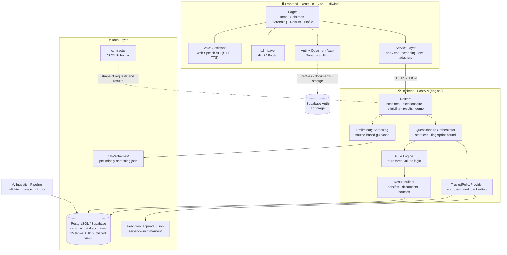
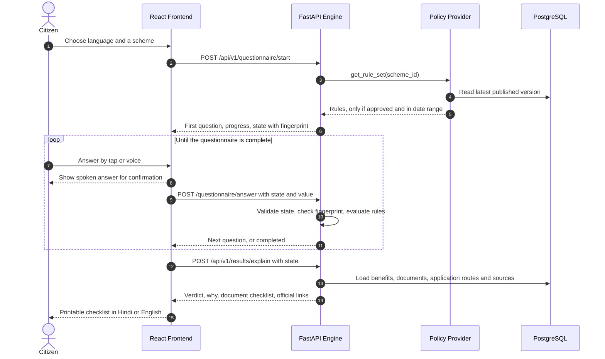
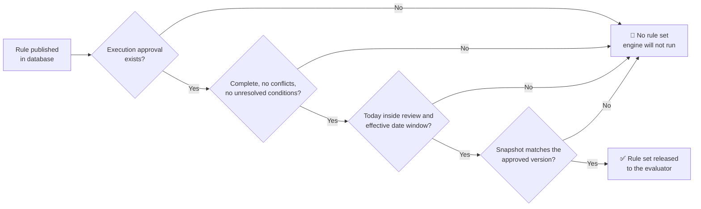
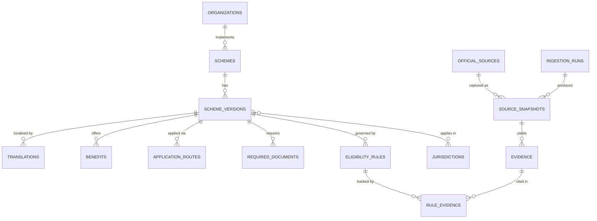

<div align="center">

# 🇮🇳 Citizen Scheme Assistant
### नागरिक योजना सहायक

**A bilingual (Hindi / English), privacy-first assistant that tells citizens which government schemes they are likely eligible for, explains *why* in plain language, and hands them a printable document checklist.**

<br/>


[Problem](#-the-problem) · [Features](#-key-features) · [Architecture](#-system-architecture) · [How it works](#-how-a-screening-works) · [API](#-api-reference) · [Quick start](#-quick-start) · [Testing](#-testing) · [Roadmap](#-roadmap)

</div>

---

## 🎯 The Problem

Millions of Indian citizens qualify for central and state welfare schemes and **never apply**. The reasons are consistent: dense bureaucratic language, scattered portals, uncertainty about eligibility, and fear of a rejected application or a wasted trip to an office.

The people who need help most are often using a **low-end Android phone**, a **shared family phone**, or a **Common Service Centre (CSC)** computer, and are most comfortable in **Hindi**.

**Citizen Scheme Assistant** is built for exactly that user.

| Citizen pain point | How this project answers it |
| :--- | :--- |
| *"I can't read the official portal."* | Full Hindi + English interface, **voice input and read-aloud** |
| *"Am I even eligible?"* | A deterministic rule engine asks only the questions that matter and explains the deciding rule |
| *"What if the system is wrong?"* | It **never guesses**. Missing or borderline data becomes *Needs verification*, not a false *Eligible* |
| *"Which documents do I carry?"* | A consolidated, **printable document checklist** with official source links |
| *"This is a shared phone."* | Anonymous screening lives in session memory only, and nothing is left behind |

---

## ✨ Key Features

### 🧠 Trustworthy eligibility engine
- **Pure three-valued logic** (met / not met / unknown). The evaluator has no network, SQL, LLM, logging or storage access, so every verdict is reproducible and auditable.
- **No AI hallucination for legal entitlements.** Rules come from reviewed, published data and never from a language model.
- **Strict type validation.** There is no implicit Boolean, string or income-unit coercion, and no silent rounding of income.
- **Honest outcomes:** `ELIGIBLE_LIKELY`, `NOT_ELIGIBLE_LIKELY` and `NEEDS_VERIFICATION`. Preliminary guidance never claims a guaranteed approval.

### 🔐 Approval-gated, versioned policies
- A scheme's rules execute **only if a server-owned approval manifest allows it**. Publishing a rule in the database is not enough on its own.
- Approvals carry review dates, validity windows, conflict flags and unresolved-condition checks.
- A **SHA-256 policy fingerprint** is bound to every questionnaire state. If rules change mid-session, the API returns `409 POLICY_CHANGED` instead of mixing old answers with new rules.

### 🗣️ Built for accessibility
- Hindi ⇄ English switching across the whole UI, with Devanagari typography.
- **Voice assistant** using the Web Speech API (speech recognition plus read-aloud). A spoken answer is shown in a **confirmation modal** before submission, and unrecognised speech is rejected.
- Status badges use **icon + text, not colour alone**.

### 🗂️ Document guidance and vault
- Source-backed required, conditional and optional document lists, each with an official link and a "last checked" date.
- **Document ownership checklist** and sample document previews (Aadhaar, ration card, income, caste, domicile, bank passbook).
- Sensitive identity proofs (**Aadhaar and bank passbook**) are **tick-only and are never uploaded**.
- Optional signed-in profile with private document storage and **automatic expiry cleanup** of stored documents and profile details.

### 🛡️ Security-minded backend
- Explicit-origin CORS (wildcards rejected at startup) and `GET`/`POST` only.
- Catalogue database in a **private Postgres schema** with row-level security, a read-only reader role, and `security_barrier` views over published data only.
- Loopback-only, opt-in demo routes that return `404` anywhere else.
- Consistent typed error envelope (`error.code`, `error.fields`).

---

## 🏗️ System Architecture

The system separates **presentation**, **decision logic** and **data** so that no layer can quietly take over another's job.



### Design principles

| # | Principle | What it means in code |
| :-: | :--- | :--- |
| 1 | **Zero scheme logic in the frontend** | The UI collects answers and renders results. Thresholds, age limits and document rules never live in React. |
| 2 | **Rules are data, not code** | Scheme rules come from reviewed, versioned records, so updating a limit needs no engine redeploy. |
| 3 | **Never guess, never invent** | Missing or borderline facts resolve to *needs verification*. Unverified application URLs are explicitly labelled unavailable. |
| 4 | **Stateless by design** | No server-side session store. The questionnaire state is passed back and forth and validated on every call. |
| 5 | **Publication ≠ execution** | A rule must be published **and** approved (reviewed, in date range, conflict-free) before it can run. |
| 6 | **Contracts at the boundary** | Request and result shapes are defined by JSON Schemas in `contracts/` and enforced by Pydantic models. |

---

## 🔄 How a Screening Works



**Why this design works**

- **Minimal question burden.** The backend decides the next question, so citizens answer only what can still change the outcome.
- **Skip / "I don't know" / clear** are first-class actions. An unknown answer produces *needs verification*, never a silent assumption.
- **Back-navigation and language switching** re-derive the question from the saved state without losing answers.
- Stale responses are discarded by a revision counter in `ScreeningFlow`, so rapid taps cannot corrupt the UI.

### The trust gate: when is a rule allowed to run?



---

## 📡 API Reference

Base URL (local): `http://127.0.0.1:8000` · Interactive docs: **`/docs`** (Swagger) · Schema: `/openapi.json`

| Method | Endpoint | Purpose |
| :---: | :--- | :--- |
| `GET` | `/health` | Liveness check (no database dependency) |
| `GET` | `/api/v1/meta/languages` | Supported interface languages (`en`, `hi`) |
| `GET` | `/api/v1/meta/health/db` | Read-only database connectivity check (`503` on failure) |
| `GET` | `/api/v1/schemes` | Published schemes. Params: `lang`, `search`, `level`, `limit`, `offset` |
| `GET` | `/api/v1/schemes/{scheme_id}` | Scheme detail: benefits, routes, documents, rules, sources |
| `POST` | `/api/v1/questionnaire/start` | Begin a screening with `{scheme_id, language}` |
| `POST` | `/api/v1/questionnaire/next` | Refresh, change language or restore history from `{state}` |
| `POST` | `/api/v1/questionnaire/answer` | Submit an `answer`, `skip` or `clear` action |
| `POST` | `/api/v1/eligibility/evaluate` | Evaluate answers against an approved rule set |
| `POST` | `/api/v1/results/explain` | Source-backed explanation, documents and application guidance |
| `*` | `/api/v1/demo/...` | Development-only preview catalogue (loopback only) |

<details>
<summary><b>Example: the stateless questionnaire contract</b></summary>

```http
POST /api/v1/questionnaire/answer
Content-Type: application/json

{
  "state": { "...returned by the previous call, passed back unchanged..." },
  "question_id": "age",
  "action": "answer",
  "value": 34
}
```

- Booleans stay booleans, integers stay numeric, and income uses a **decimal string** to preserve precision.
- Categories must be backend-approved codes.
- Listing responses include `total`, `limit`, `offset` and `has_more`. Counts and pages are read from one `REPEATABLE READ` snapshot.

</details>

---

## 🗃️ Data Model

The catalogue lives in a private Postgres schema, `scheme_catalog`, defined by three ordered migrations in `engine/supabase/migrations/`.



**Provenance is first-class:** versions, evidence, official sources and ingestion runs are tracked so every displayed fact can be traced to an official source. Only the ten `published_*` views are readable by the API's database role.

---

## 📁 Repository Structure

```text
citizen-scheme-assistant/
├── frontend/                        # ⚛️ React + Vite client
│   ├── src/
│   │   ├── pages/                   # Home, Schemes, SchemeDetails, Screening, Results, Login, Signup, Profile
│   │   ├── components/
│   │   │   ├── common/              # Navbar, Footer, Disclaimer, StatusBadge, LanguageSwitcher, states
│   │   │   ├── home/                # Hero, SearchBar, HowItWorks, FeaturedSchemes, TrustPrivacy
│   │   │   ├── schemes/             # SchemeCard, FilterSidebar, SourceReferences
│   │   │   ├── questionnaire/       # QuestionInput, VoiceAssistant
│   │   │   ├── results/             # ResultCard, DocumentChecklist (printable)
│   │   │   └── documents/           # DocumentCard, DocumentPreviewModal
│   │   ├── services/                # apiClient, schemeApi, sessionApi, screeningFlow, adapters
│   │   ├── auth/                    # AuthContext, ProtectedRoute
│   │   ├── i18n/                    # translations, LanguageContext
│   │   ├── config/                  # document types and matching, income bands
│   │   └── mock/                    # contract-shaped mock data for offline UI work
│   └── tests/                       # Node test-runner suites
│
├── engine/                          # 🐍 FastAPI decision engine
│   ├── main.py                      # App entry, CORS, routers, /health
│   ├── app/
│   │   ├── api/routes/              # schemes, questionnaire, eligibility, results, demo
│   │   ├── eligibility/             # engine, questionnaire, provider, approvals, preliminary, results
│   │   ├── schemas/                 # Pydantic request/response models
│   │   ├── db/                      # connection, repository, policies, guidance
│   │   └── core/                    # config, typed errors
│   ├── ingestion/                   # catalogue validation, staging and Postgres import
│   ├── supabase/migrations/         # catalogue schema, integrity rules, backend access
│   ├── reviewer/                    # review and preview tooling
│   └── tests/                       # backend test suites
│
├── contracts/                       # 📜 JSON Schemas (scheme, citizen profile, eligibility result)
├── data/schemes/                    # 📦 Source-based preliminary screening catalogue
└── docs/                            # 📚 PRD, architecture, privacy, decisions, glossary
```

---

## 🧰 Tech Stack

| Layer | Technology |
| :--- | :--- |
| **Frontend** | React 18, Vite 5, React Router 6, Tailwind CSS 3, Lucide Icons |
| **Voice** | Web Speech API (`SpeechRecognition` + `SpeechSynthesis`) |
| **Fonts** | Inter, Noto Sans Devanagari |
| **Backend** | Python, FastAPI, Uvicorn, Pydantic |
| **Database** | PostgreSQL via Supabase migrations, accessed with `psycopg 3` |
| **Auth / Storage** | Supabase Auth and private Storage (optional signed-in profile) |
| **Validation** | JSON Schema contracts, Pydantic strict models, PGlite-based migration tests |

---

## 🚀 Quick Start

### Prerequisites
- **Node.js 18+** (22+ to run the database-migration tests)
- **Python 3.12+**
- A PostgreSQL / Supabase database (needed only for the published-catalogue endpoints)

### 1 · Clone
```bash
git clone https://github.com/CmdMayank/beta-06.git
cd beta-06/citizen-scheme-assistant
```

### 2 · Run the backend
```bash
cd engine
python -m venv .venv

# Windows
.\.venv\Scripts\activate
# macOS / Linux
source .venv/bin/activate

pip install -r requirements.txt -r requirements-test.txt
uvicorn main:app --reload
```
API: **http://127.0.0.1:8000** · Swagger: **http://127.0.0.1:8000/docs**

### 3 · Run the frontend
```bash
cd ../frontend
npm install
npm run dev
```
Open **http://localhost:5173**.

### 4 · Configuration

| Variable | Where | Purpose |
| :--- | :--- | :--- |
| `VITE_API_BASE_URL` | frontend | Backend origin (e.g. `http://127.0.0.1:8000`) |
| `VITE_DEFAULT_LANGUAGE` | frontend | Initial UI language (`hi` or `en`) |
| `VITE_USE_MOCK` | frontend | `true` to run the UI on contract-shaped mock data |
| `CORS_ORIGINS` | engine | Comma-separated explicit origins allowed to call the API |
| `SCHEME_APP_ENV` | engine | Environment name (defaults to `development`) |
| `SCHEME_DEMO_ENABLED` | engine | `1` enables loopback-only demo routes |

> Copy `.env.example` to `.env` and adjust. Never put database credentials in `VITE_*` variables or browser code.

---

## 🧪 Testing

```bash
# Backend: rule engine, questionnaire, policy provider, API, results, ingestion
cd engine
python -m unittest discover -s tests -v

# Frontend: rendering, integration and preview suites
cd frontend
npm test

# Database migrations, executed in an in-memory Postgres (PGlite)
npm --prefix engine/db-validation ci
npm --prefix engine/db-validation test
```

**What is covered:** three-valued rule evaluation, questionnaire state validation and fingerprinting, approval gating, result building, repository and Postgres import behaviour, the demo bridge, and frontend integration with the API contract.

---

## 🔒 Privacy by Design

| Data | Handling |
| :--- | :--- |
| Screening answers and results | Held in browser session memory, cleared on tab close or **"Clear Data / New Citizen"** |
| Server-side sessions | **None.** The API is stateless |
| Aadhaar and bank passbook | **Tick-only**, never uploaded |
| Optional profile and documents | Private storage with an expiry date, cleaned up automatically |
| Third-party analytics | None |
| Branding | Independent project. Every screen carries *"Independent project, not an official government website."* |

---

## 🗺️ Roadmap

- [x] Bilingual UI with voice input and read-aloud
- [x] Stateless, fingerprint-bound questionnaire engine
- [x] Approval-gated rule execution and published-catalogue API
- [x] Private catalogue schema with provenance and ingestion pipeline
- [x] Printable document checklist and document vault
- [ ] Expand the reviewed, approved scheme catalogue (more central and state schemes)
- [ ] Additional regional languages
- [ ] Offline-first PWA for low-bandwidth devices
- [ ] CI pipeline and one-command Docker deployment
- [ ] Accessibility audit (WCAG 2.1 AA)

---

## 🤝 Contributing

Contributions are welcome. Please read [`CONTRIBUTING.md`](./CONTRIBUTING.md) first, and keep the three ground rules:

1. **No eligibility logic in `frontend/`.**
2. **No hardcoded UI strings.** Use the Hindi and English translation keys.
3. **Contracts are shared.** Changes to `contracts/` need team agreement and a note in `docs/DECISIONS.md`.

## 👥 Contributors

<a href="https://github.com/CmdMayank/beta-06/graphs/contributors">
  
</a>

---

<div align="center">

**Built so that no citizen misses a benefit they deserve.**

*Preliminary guidance only. This is not government approval, enrolment or a guarantee of payment. The official implementing agency makes the final decision.*

⭐ If this project helps you, consider giving it a star.

</div>
