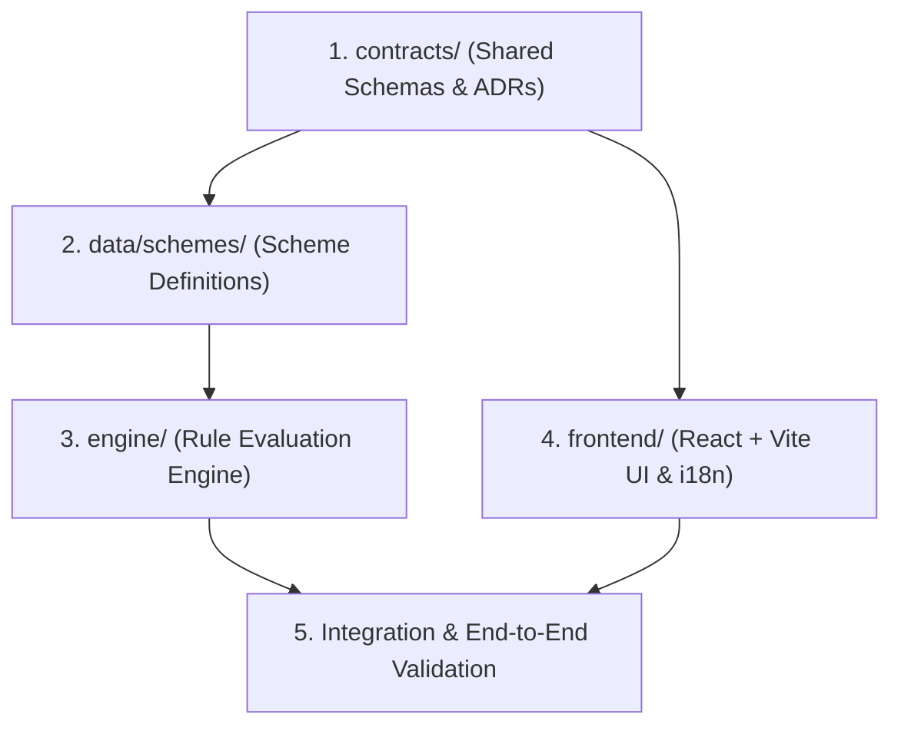

# Contributing Guidelines

Thank you for contributing to the **Citizen Scheme Assistant** project. These guidelines ensure our 4-person team works smoothly across independent modules without merge conflicts or broken contracts.

---

## 1. Branch Naming Convention

Always branch off `main`. Use descriptive, prefixed branch names:

| Scope | Prefix | Example |
| :--- | :--- | :--- |
| **Frontend UI** | `feat/frontend-` | `feat/frontend-bilingual-toggle` |
| **Eligibility Engine** | `feat/engine-` | `feat/engine-decision-tree` |
| **Scheme Data** | `data/scheme-` | `data/scheme-pm-kisan` |
| **Shared Contracts** | `contract/` | `contract/update-profile-schema` |
| **Documentation** | `docs/` | `docs/update-prd-acceptance-criteria` |
| **Bug Fixes** | `fix/` | `fix/frontend-speech-synthesis-hang` |

---

## 2. Commit Message Guidelines

We follow the [Conventional Commits](https://www.conventionalcommits.org/) specification:

```
<type>(<scope>): <short description in present tense>
```

### Allowed Types:
- `feat`: A new user-facing or engine feature
- `fix`: A bug fix
- `data`: Adding or updating scheme rule JSON files
- `contract`: Updating shared schemas in `contracts/`
- `docs`: Documentation updates only
- `refactor`: Code change that neither fixes a bug nor adds a feature
- `test`: Adding or updating test cases
- `chore`: Tooling, build config, dependencies

### Examples:
- `feat(frontend): implement speech recognition for Hindi answers`
- `data(pm-jay): add official 2026 eligibility criteria and source URL`
- `contract(eligibility): add uncertainty_reasons field to result schema`
- `docs(prd): refine acceptance criteria for R5 edge cases`

---

## 3. Pull Request Checklist

Before submitting a PR, verify:
- [ ] **Folder boundary respected**: The PR modifies only files in your assigned domain.
- [ ] **No hardcoded text**: No hardcoded Hindi or English UI strings (all UI strings use i18n keys).
- [ ] **Contract compliance**: If your PR touches `contracts/`, it includes an update to `docs/DECISIONS.md` signed off by teammates.
- [ ] **Schema validation**: Any new scheme in `data/schemes/` validates against `contracts/scheme.schema.json`.
- [ ] **No PII logging**: No `console.log` statements dumping citizen inputs (income, land size, etc.).
- [ ] **Official citations**: Any new scheme has an official `.gov.in` source link and verified `last_checked_date`.

---

## 4. Merge Order & Dependency Hierarchy

To prevent integration roadblocks, features must be merged in this exact sequence:



1. **Step 1: Contracts (`contracts/`)**: Schemas must be merged and agreed upon before engine or frontend implementation.
2. **Step 2: Data Schemas (`data/schemes/`)**: At least 5 baseline schemes must be validated against `contracts/scheme.schema.json`.
3. **Step 3: Engine (`engine/`)**: Implements logic consuming `data/schemes/` and emits `eligibility-result.schema.json`.
4. **Step 4: Frontend (`frontend/`)**: Builds screens using mock contract responses, then connects to the engine.
5. **Step 5: End-to-End Integration**: Full pass testing bilingual voice input, checklist export, and shared-phone privacy reset.

