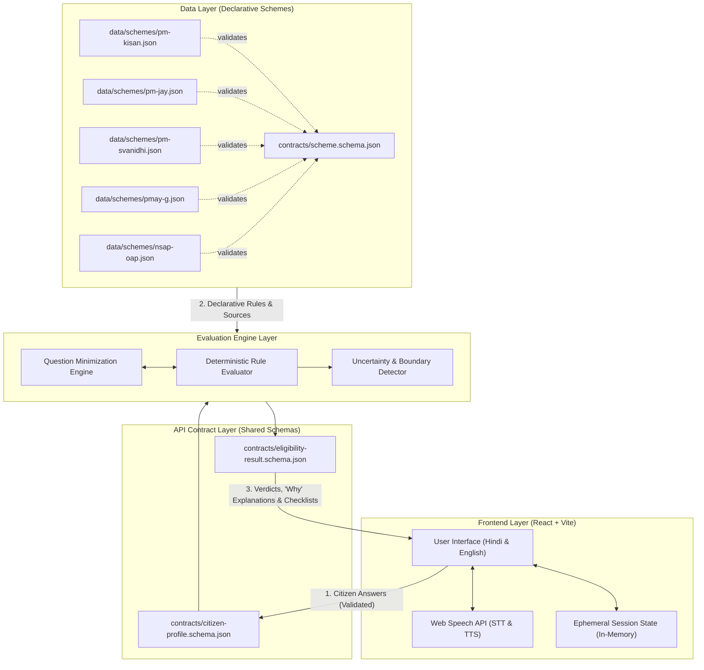

# System Architecture

**Citizen Scheme Assistant (नागरिक योजना सहायक)**  
Document Version: 1.0.0

---

## 1. High-Level Architecture Diagram

The system decouples user interaction from business logic and data definitions.

---

## 2. Core Architectural Invariants

### 1. Zero Scheme Rules in the Frontend
- The `frontend/` layer is **strictly a presentation and collection harness**.
- The frontend **never** decides eligibility. It has no knowledge of criteria like *"annual income must be under ₹2,00,000"* or *"applicant must be over 60 years old"*.
- The frontend **never** hardcodes scheme titles, scheme descriptions, criteria text, or document lists. Everything displayed about a scheme is dynamically populated from the engine's output and scheme data definitions.

### 2. Scheme Rules Live Only in `data/schemes/`
- Every government scheme is declared as a self-contained JSON file inside `data/schemes/`.
- Changing an income threshold, updating an age bracket, adding a new required document, or modifying an official source URL is accomplished solely by updating that scheme's JSON file.
- No application code rewrite or redeployment of engine logic is required when a rule updates.

### 3. Decoupled Communication via Rigid Contracts
- Interactions between the frontend and the engine strictly adhere to JSON schemas located in `contracts/`:
  - `contracts/citizen-profile.schema.json`: Represents citizen demographic and socioeconomic answers.
  - `contracts/eligibility-result.schema.json`: Encapsulates evaluation status (`ELIGIBLE`, `INELIGIBLE`, `UNCERTAIN`), the plain-text explanation of the deciding rule, the official source URL, last checked date, and required document checklist.

---

## 3. Data Flow Walkthrough

1. **Step 1: Session Initiation**  
   The user selects their preferred language (Hindi or English). The frontend initializes an ephemeral in-memory state. No server cookies or persistent tokens are generated.

2. **Step 2: Question Traversal**  
   The engine computes the next highest-entropy question (e.g., *"Are you an agricultural landowner?"*). The frontend renders the question with corresponding audio read-out and speech recognition triggers.

3. **Step 3: Answer Ingestion & Schema Validation**  
   Answers are validated against `contracts/citizen-profile.schema.json` and passed to the evaluation engine.

4. **Step 4: Rule Evaluation & Uncertainty Detection**  
   For each scheme defined in `data/schemes/*.json`, the engine evaluates:
   - **Satisfied Conditions**: Meets all positive criteria.
   - **Disqualifying Conditions**: Violates exclusion criteria (e.g., pays income tax, owns more than 2 hectares).
   - **Borderline / Missing Data**: If a decisive criterion is unanswered or borderline, the scheme is marked `UNCERTAIN` and the missing dependency is recorded.

5. **Step 5: Response Construction**  
   The engine packages the results according to `contracts/eligibility-result.schema.json`, including localized explanations in the active language.

6. **Step 6: Presentation & Checklist Generation**  
   The frontend renders the scheme cards grouped by status. For qualifying and borderline schemes, the frontend compiles the document checklist ready for offline mobile viewing or printing.

7. **Step 7: Session Wipe**  
   Upon tapping "Clear Data / नया नागरिक" or on browser session termination, all answers and evaluations are purged from device memory.

